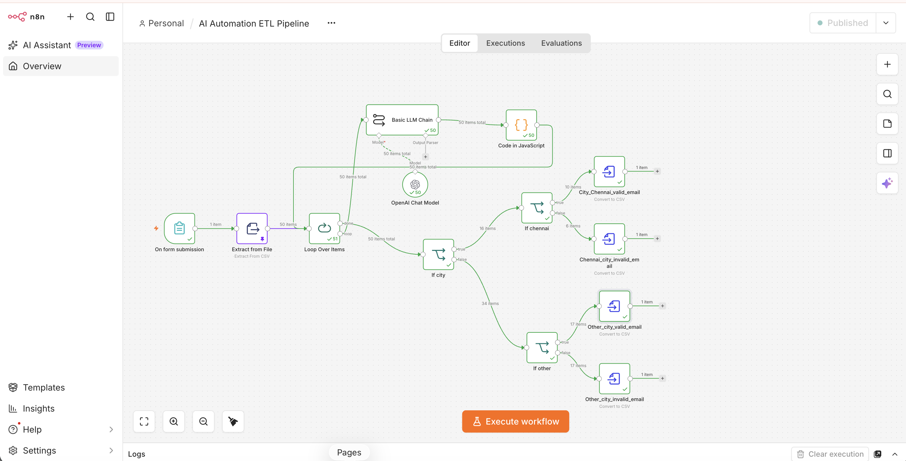
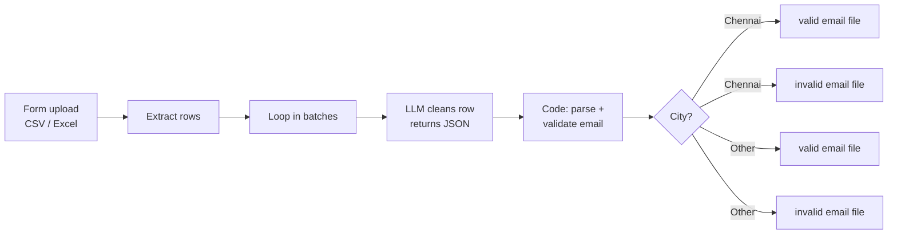

# AI-Powered ETL Pipeline (n8n)

Upload a messy spreadsheet and get clean, validated, sorted output files back. An LLM cleans each row (fixes names, cities, casing and formats), code validates it, and the pipeline splits the results into separate files.

## Pipeline

**Example** (student enrolment data): the row `priya s, priya.s@example, CHENNAI, python, YES, 13-02-2025` becomes
`{"Name": "Priya S", "Email": "INVALID_EMAIL", "City": "Chennai", "Course": "Python", "Fee_Paid": true, "Enrolled_Date": "2025-02-13"}`
and lands in the *Chennai: invalid email* file.

**Cleaning rules given to the LLM:** Title Case names and cities, flag invalid emails, mark phones under 10 digits as `MISSING`, map courses to Python / Machine Learning / Data Science, convert yes/no to true/false, and format dates as YYYY-MM-DD.

## Why use an LLM here?

Rule-based cleaning breaks on free-text mess: misspelt city names, mixed formats, inconsistent yes/no values. The LLM normalises those, and deterministic code still makes the final validation decision, so the output stays reliable.

## Setup

1. In n8n: **Workflows → Import from File** → `AI Automation ETL Pipeline.json`.
2. Add an OpenAI credential to the chat model node.
3. Activate it, open the form URL and upload a CSV or Excel file.

Use your own test data; no sample personal data is stored in this repo.

## Tech stack

n8n · OpenAI · JavaScript (Code node) · Form trigger · batch processing
